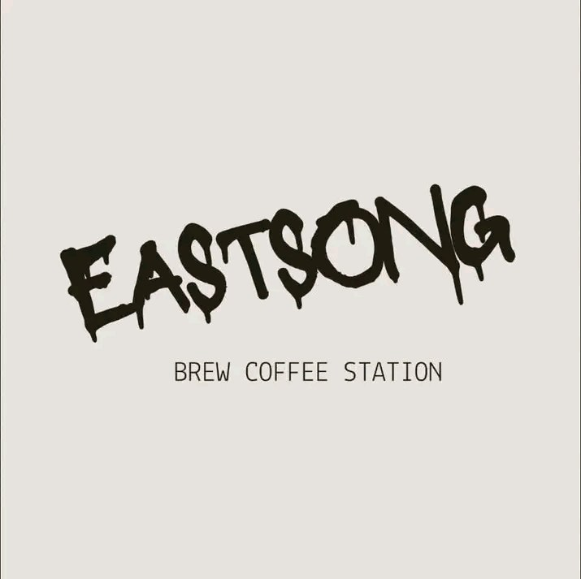

# EastSong Brew Coffee Station

Static website, no build step. Open every day, Monday to Sunday, 5:00 PM to 12:00 AM.

All files go in the **same place** (no folders). The repo ends up like this:

```
index.html
style.css
app.js
vercel.json
README.md
logo.jpg
iced-latte.jpg
salted-caramel.jpg
mocha.jpg
dark-choco.jpg
oreo-choco.jpg
oreo-cream.jpg
black-coffee.jpg
coffee-matcha.jpg
milky-matcha.jpg
```

## Upload from your phone (GitHub in the browser)

**Step 1: the 10 photos (.jpg).** Photos can't be typed or pasted, so upload them as files.

1. Open your repo on github.com in your phone browser.
2. Tap **Add file**, then **Upload files**.
3. Tap **choose your files** and select all 10 `.jpg` photos from your phone.
4. Tap **Commit changes**.

**Step 2: the 4 code files.** Copy and paste each one from the sections below.

1. Tap **Add file**, then **Create new file**.
2. In the name box type the file name exactly, for example `index.html`.
3. Open the section for that file below, tap and hold inside the code box, **Select all**, **Copy**.
4. Paste into the big GitHub text box and tap **Commit changes**.
5. Repeat for `style.css`, `app.js` and `vercel.json`.

(If you already downloaded the files, you can instead upload them in Step 1 together with the photos.)

Check that `index.html` is at the top of the repo, not inside a folder.

## Deploy on Vercel

1. Go to vercel.com and sign in with GitHub.
2. Add New, then Project, then import your repo.
3. Framework Preset: **Other**.
4. Leave Build Command, Output Directory and Install Command empty.
5. Tap **Deploy**. Every later change on GitHub redeploys the site automatically.

## Edit later

At the top of `app.js` you can change the Google Maps link, Facebook page, opening hours, drink and food names and prices. To change a photo, upload a new one with the same file name.

---

# The code

### `index.html`

````html
<!DOCTYPE html>
<html lang="en">
<head>
<meta charset="utf-8">
<meta name="viewport" content="width=device-width, initial-scale=1, viewport-fit=cover">
<meta name="theme-color" content="#000000">
<title>EastSong Brew Coffee Station | Open daily 5 PM to 12 AM</title>
<meta name="description" content="EastSong Brew Coffee Station: iced coffee, chocolate, matcha, siomai and siopao. Open every day from 5 PM to 12 AM.">
<meta property="og:title" content="EastSong Brew Coffee Station">
<meta property="og:description" content="Night Owl menu: iced coffee, chocolate, matcha, siomai and siopao. Open daily 5 PM to 12 AM.">
<meta property="og:image" content="logo.jpg">
<link rel="icon" href="logo.jpg">
<link rel="preconnect" href="https://fonts.googleapis.com">
<link rel="preconnect" href="https://fonts.gstatic.com" crossorigin>
<link href="https://fonts.googleapis.com/css2?family=Sniglet:wght@400;800&family=Mansalva&family=Space+Mono:wght@400;700&display=swap" rel="stylesheet">
<link rel="stylesheet" href="style.css">
</head>
<body>

<header class="top">
  <div class="wrap bar">
    <a class="brand" href="#top" aria-label="EastSong Brew Coffee Station, home">
      
      <span>EastSong Brew</span>
    </a>
    <nav aria-label="Main">
      <a href="#menu">Menu</a>
      <a href="#food">Food</a>
      <a href="#visit">Visit</a>
    </nav>
  </div>
</header>

<main id="top">
  <section class="hero">
    <div class="wrap hero-grid">
      <div class="logo-disc"></div>
      <div class="hero-text">
        <p class="status" id="status" hidden></p>
        <h1>EastSong Brew<br>Coffee Station</h1>
        <p class="hours-line">Open every day, Monday to Sunday<br><b>5:00 PM to 12:00 AM</b></p>
        <div class="cta">
          <a class="btn" href="#menu">See the menu</a>
          <a class="btn ghost" id="dirTop" href="#visit" target="_blank" rel="noopener">Directions</a>
        </div>
      </div>
    </div>
  </section>

  <section class="chap" id="menu">
    <div class="wrap">
      <h2 class="title"><span class="night">Night Owl</span> <span class="script">Menu</span></h2>
      <p class="intro">Iced drinks for late evenings. Tap a size to add it to your order.</p>
      <div id="drinkGroups"></div>
    </div>
  </section>

  <section class="chap" id="food">
    <div class="wrap">
      <h2 class="title"><span class="night">Food</span> <span class="script">Bites</span></h2>
      <p class="intro">Hot and ready for the night shift.</p>
      <div class="panel foods" id="foodList"></div>
    </div>
  </section>

  <section class="chap" id="visit">
    <div class="wrap">
      <h2 class="title"><span class="night">Visit</span> <span class="script">Us</span></h2>
      <div class="visit-grid">
        <div>
          <h3>New location</h3>
          <p>Find us on Google Maps. Tap below for directions from where you are.</p>
          <div class="cta left">
            <a class="btn" id="mapBtn" href="#" target="_blank" rel="noopener">Open in Google Maps</a>
            <a class="btn ghost" id="fbBtn" href="#" target="_blank" rel="noopener">Facebook page</a>
          </div>
        </div>
        <div>
          <h3>Opening hours</h3>
          <table class="hours" id="hours"></table>
        </div>
      </div>
    </div>
  </section>
</main>

<footer>
  <div class="wrap foot">
    
    <span>EastSong Brew Coffee Station</span>
    <span>&copy; <span id="yr"></span></span>
  </div>
</footer>

<button class="cart-pill" id="cartPill" type="button" hidden aria-haspopup="dialog">
  <span id="pillText">View order</span><b id="pillTotal"></b>
</button>

<dialog id="tray" aria-labelledby="trayTitle">
  <div class="tray-in">
    <div class="tray-head">
      <h3 id="trayTitle">Your order</h3>
      <button class="x" id="closeTray" type="button" aria-label="Close order">&times;</button>
    </div>
    <ul id="trayList"></ul>
    <div class="total"><span>Total</span><b id="trayTotal">₱0</b></div>
    <p class="fine">Just a running total to help you choose. Show it to the barista when you order. Nothing is sent or paid here.</p>
    <button class="btn ghost" id="clearTray" type="button">Clear order</button>
  </div>
</dialog>

<div id="toast" role="status" aria-live="polite"></div>
<script src="app.js"></script>
</body>
</html>
````

### `style.css`

````css
:root{
  --ink:#000;
  --cream:#EEE3DD;
  --peach:#F5D2AE;
  --copper:#C2652E;
  --pine:#1F4B3E;
  --soft:#1a1714;
  --mute:#b8aca3;
  --line:rgba(245,210,174,.55);
}
*{box-sizing:border-box}
[hidden]{display:none!important}
html{scroll-behavior:smooth;scroll-padding-top:70px;-webkit-text-size-adjust:100%}
body{margin:0;background:var(--ink);color:var(--cream);font-family:'Sniglet','Trebuchet MS',system-ui,sans-serif;font-size:17px;line-height:1.55;overflow-x:hidden;padding-bottom:env(safe-area-inset-bottom,0)}
img{max-width:100%;display:block}
a{color:var(--peach)}
button{font:inherit;color:inherit;cursor:pointer;touch-action:manipulation}
a,button{-webkit-tap-highlight-color:rgba(245,210,174,.25)}
:focus-visible{outline:3px solid var(--peach);outline-offset:3px;border-radius:6px}
.wrap{width:min(1040px,100% - 2rem);margin-inline:auto}

/* header */
.top{position:sticky;top:0;z-index:30;background:rgba(0,0,0,.9);backdrop-filter:blur(8px);border-bottom:1px solid rgba(245,210,174,.2);padding-top:env(safe-area-inset-top,0)}
.bar{display:flex;align-items:center;justify-content:space-between;gap:1rem;min-height:60px}
.brand{display:flex;align-items:center;gap:.65rem;text-decoration:none;color:var(--cream);font-weight:800;font-size:1.05rem}
.brand img{width:40px;height:40px;border-radius:50%;border:2px solid var(--pine);object-fit:cover}
nav{display:flex;gap:1.25rem}
nav a{color:var(--cream);text-decoration:none;padding:.4rem 0;border-bottom:2px solid transparent}
nav a:hover{border-color:var(--copper)}

/* hero */
.hero{padding:clamp(2rem,6vw,4.5rem) 0 clamp(2.5rem,6vw,4rem)}
.hero-grid{display:grid;grid-template-columns:minmax(0,.9fr) minmax(0,1.1fr);gap:clamp(1.5rem,4vw,3.5rem);align-items:center}
.logo-disc{width:min(420px,100%);aspect-ratio:1;border-radius:50%;overflow:hidden;border:8px solid var(--pine);justify-self:center;background:var(--cream)}
.logo-disc img{width:100%;height:100%;object-fit:cover;transform:scale(1.02)}
.hero h1{font-size:clamp(2.2rem,6.4vw,4.2rem);line-height:1.02;margin:.3rem 0 1rem;font-weight:800;color:#fff;text-shadow:3px 3px 0 #5c3a22}
.hours-line{font-size:1.15rem;color:var(--mute);margin:0 0 1.5rem}
.hours-line b{color:var(--peach);font-size:1.4rem}
.cta{display:flex;gap:.75rem;flex-wrap:wrap}
.btn{display:inline-flex;align-items:center;justify-content:center;min-height:46px;padding:.65rem 1.4rem;border-radius:999px;border:2px solid var(--peach);background:var(--peach);color:#1b120b;font-weight:800;text-decoration:none;transition:transform .12s ease,background .12s ease}
.btn:hover{background:#fbe0c4}
.btn:active{transform:scale(.97)}
.btn.ghost{background:transparent;color:var(--peach)}
.btn.ghost:hover{background:rgba(245,210,174,.12)}
.status{display:inline-flex;align-items:center;gap:.5rem;margin:0;font-weight:800;font-size:.95rem;padding:.3rem .9rem;border-radius:999px;border:1.5px solid var(--line);color:var(--mute)}
.status::before{content:"";width:.65rem;height:.65rem;border-radius:50%;background:#7a6f66}
.status.open{color:#bfe8c9;border-color:#3f8f66}
.status.open::before{background:#41c47f}

/* sections */
.chap{padding:clamp(2.5rem,6vw,4rem) 0}
.title{text-align:center;margin:0 0 .4rem;line-height:1;display:flex;justify-content:center;align-items:baseline;gap:.5rem;flex-wrap:wrap}
.title .night{font-size:clamp(2.4rem,9vw,4.4rem);font-weight:800;color:#fff;text-shadow:3px 3px 0 #5c3a22;text-transform:uppercase}
.title .script{font-family:'Mansalva','Segoe Script',cursive;font-size:clamp(2.6rem,10vw,5rem);color:var(--copper);font-weight:400}
.intro{text-align:center;color:var(--mute);margin:0 auto 2rem;max-width:46ch}

.panel{border:2px solid var(--line);border-radius:clamp(26px,5vw,46px);padding:clamp(1rem,3vw,1.75rem);margin-bottom:1.5rem;position:relative}
.grid{display:grid;grid-template-columns:repeat(3,minmax(0,1fr));gap:clamp(.5rem,2vw,1.5rem)}
.drink{display:flex;flex-direction:column;align-items:center;text-align:center;gap:.4rem}
.drink .ph{width:100%;aspect-ratio:4/5;display:flex;align-items:center;justify-content:center}
.drink img{max-height:100%;width:auto;max-width:100%;object-fit:contain}
.drink h3{margin:.2rem 0 0;font-size:clamp(.85rem,2.6vw,1.2rem);line-height:1.15;text-transform:uppercase;letter-spacing:.02em;font-weight:800}
.sizes{display:flex;flex-direction:column;gap:.35rem;width:100%;max-width:170px}
.sz{display:flex;justify-content:space-between;align-items:center;gap:.5rem;min-height:42px;padding:.3rem .8rem;border-radius:999px;border:1.5px solid var(--peach);background:transparent;color:var(--cream);font-weight:800;font-size:clamp(.78rem,2.4vw,.95rem)}
.sz span{color:var(--mute);font-weight:400}
.sz:hover,.sz:active{background:var(--peach);color:#1b120b}
.sz:hover span,.sz:active span{color:#3a2a1c}
.squig{position:absolute;top:50%;width:54px;height:auto;opacity:.95;pointer-events:none}
.squig.l{left:-10px}.squig.r{right:-10px}

.foods{display:grid;grid-template-columns:repeat(2,minmax(0,1fr));gap:1rem}
.food{display:flex;flex-direction:column;align-items:center;text-align:center;gap:.4rem;padding:1.25rem .5rem}
.food .emoji{font-size:clamp(3rem,12vw,4.5rem);line-height:1}
.food h3{margin:0;font-size:clamp(1.2rem,4vw,1.6rem);text-transform:uppercase;font-weight:800}
.food .price{font-size:1.2rem;color:var(--peach);font-weight:800}
.food .sz{width:100%;max-width:170px;justify-content:center;gap:.5rem}

/* visit */
.visit-grid{display:grid;grid-template-columns:1fr 1fr;gap:clamp(1.5rem,4vw,3rem);align-items:start;margin-top:1.5rem}
.visit-grid h3{margin:0 0 .6rem;font-size:1.5rem;color:var(--peach)}
.visit-grid p{color:var(--mute);margin:0 0 1.25rem}
.cta.left{justify-content:flex-start}
table.hours{width:100%;border-collapse:collapse;border-top:2px solid var(--line)}
.hours th,.hours td{padding:.7rem .4rem;border-bottom:1px solid rgba(245,210,174,.2);font-weight:400}
.hours th{text-align:left}.hours td{text-align:right;color:var(--cream)}
.hours tr.today{background:rgba(194,101,46,.22)}
.hours tr.today th{font-weight:800}
.hours tr.today th::after{content:" (today)";color:var(--peach);font-size:.85rem;font-weight:400}

footer{border-top:1px solid rgba(245,210,174,.2);padding:1.75rem 0 3rem;color:var(--mute);font-size:.95rem}
.foot{display:flex;align-items:center;gap:.8rem;flex-wrap:wrap}
.foot img{border-radius:50%;border:2px solid var(--pine);width:44px;height:44px;object-fit:cover}
.foot span:last-child{margin-left:auto}

/* order */
.cart-pill{position:fixed;left:50%;transform:translateX(-50%);bottom:calc(14px + env(safe-area-inset-bottom,0px));z-index:40;display:flex;align-items:center;justify-content:space-between;gap:1.5rem;min-width:min(340px,calc(100% - 2rem));background:var(--copper);color:#fff;border:0;border-radius:999px;padding:.85rem 1.4rem;font-weight:800;box-shadow:0 8px 28px rgba(0,0,0,.6),0 0 0 2px #000}
dialog{border:2px solid var(--line);border-radius:26px;background:#0d0b09;color:var(--cream);padding:0;width:min(460px,calc(100% - 1.5rem));max-height:calc(100dvh - 2rem)}
dialog::backdrop{background:rgba(0,0,0,.75)}
.tray-in{padding:1.25rem 1.25rem 1.5rem}
.tray-head{display:flex;justify-content:space-between;align-items:center}
.tray-head h3{margin:0;font-size:1.5rem}
.x{width:44px;height:44px;border-radius:50%;border:1.5px solid var(--line);background:transparent;font-size:1.6rem;line-height:1}
#trayList{list-style:none;margin:.5rem 0 0;padding:0}
#trayList li{display:grid;grid-template-columns:1fr auto auto;gap:.6rem;align-items:center;padding:.7rem 0;border-bottom:1px dashed rgba(245,210,174,.3)}
#trayList li.empty{display:block;color:var(--mute)}
.muted{display:block;color:var(--mute);font-size:.82rem}
.qty{display:flex;align-items:center;gap:.5rem}
.qty button{width:36px;height:36px;border-radius:50%;border:1.5px solid var(--peach);background:transparent;font-weight:800;line-height:1}
.qty button:active{background:var(--peach);color:#000}
.lp{min-width:3.4rem;text-align:right;font-weight:800}
.total{display:flex;justify-content:space-between;align-items:baseline;margin-top:1rem;font-size:1.4rem}
.total b{color:var(--peach)}
.fine{font-size:.82rem;color:var(--mute);margin:.6rem 0 1rem}
#toast{position:fixed;left:50%;bottom:calc(82px + env(safe-area-inset-bottom,0px));transform:translate(-50%,20px);background:var(--cream);color:#000;padding:.5rem 1.1rem;border-radius:999px;font-weight:800;opacity:0;pointer-events:none;transition:all .25s;z-index:50;white-space:nowrap}
#toast.show{opacity:1;transform:translate(-50%,0)}

/* responsive */
@media (max-width:820px){
  .hero-grid{grid-template-columns:1fr;text-align:center}
  .logo-disc{width:min(300px,78vw)}
  .cta{justify-content:center}
  .visit-grid{grid-template-columns:1fr}
  .cta.left{justify-content:flex-start}
  .squig{display:none}
}
@media (max-width:520px){
  body{font-size:16px}
  .brand span{font-size:.95rem}
  nav{gap:.9rem;font-size:.95rem}
  .panel{padding:.8rem .5rem 1rem}
  .sz{padding:.3rem .55rem}
  .foods{gap:.5rem}
}
@media (max-width:360px){
  .brand span{display:none}
  .sizes{max-width:100%}
}
@media (min-width:1400px){body{font-size:18px}}
@media (prefers-reduced-motion:reduce){
  html{scroll-behavior:auto}
  *{transition-duration:.01ms!important}
}
````

### `app.js`

````js
/* ===== EDIT HERE ===== */
const SHOP = {
  mapLink:  'https://maps.app.goo.gl/apWe1pZ33tqqvjPx9',
  facebook: 'https://www.facebook.com/profile.php?id=61594351956609',
  timezone: 'Asia/Manila',
  open:  17,   // 5 PM  (24-hour)
  close: 24    // 12 AM (midnight)
};

/* prices: one number per size. sizes: label for each price. */
const DRINK_GROUPS = [
  [
    { id:'iced-latte',     name:'Iced Latte',      img:'iced-latte.jpg',     sizes:['12oz','16oz'], prices:[49,59] },
    { id:'salted-caramel', name:'Salted Caramel',  img:'salted-caramel.jpg', sizes:['12oz','16oz'], prices:[69,79] },
    { id:'mocha',          name:'Mocha',           img:'mocha.jpg',          sizes:['12oz','16oz'], prices:[69,79] }
  ],
  [
    { id:'dark-choco',  name:'Dark Choco',      img:'dark-choco.jpg',  sizes:['12oz','16oz'], prices:[45,55] },
    { id:'oreo-choco',  name:'Oreo Choco',      img:'oreo-choco.jpg',  sizes:['12oz','16oz'], prices:[59,69] },
    { id:'oreo-cream',  name:'Oreo C\u2019n Cream', img:'oreo-cream.jpg', sizes:['12oz'],        prices:[59] }
  ],
  [
    { id:'black-coffee',  name:'Black Coffee',  img:'black-coffee.jpg',  sizes:['16oz'], prices:[45] },
    { id:'coffee-matcha', name:'Coffee Matcha', img:'coffee-matcha.jpg', sizes:['16oz'], prices:[79] },
    { id:'milky-matcha',  name:'Milky Matcha',  img:'milky-matcha.jpg',  sizes:['16oz'], prices:[69] }
  ]
];

const FOODS = [
  { id:'siomai', name:'Siomai', emoji:'\u{1F95F}', price:6,  unit:'each' },
  { id:'siopao', name:'Siopao', emoji:'\u{1F35E}', price:15, unit:'each' }
];
/* ===================== */

const $  = (s, r=document) => r.querySelector(s);
const esc = s => String(s).replace(/[&<>"']/g, c => ({'&':'&amp;','<':'&lt;','>':'&gt;','"':'&quot;',"'":'&#39;'}[c]));
const peso = n => '\u20B1' + Number(n||0).toLocaleString('en-PH');
const tray = [];   // { key, name, size, price, qty }

const squig = side => `<svg class="squig ${side}" viewBox="0 0 110 40" aria-hidden="true"><path d="M8 24 C20 4 32 4 44 20 S68 36 80 18 S98 8 104 16" fill="none" stroke="#F5D2AE" stroke-width="14" stroke-linecap="round"/></svg>`;

function sizeBtn(id, name, size, price){
  return `<button class="sz" type="button" data-add="${esc(id)}|${esc(name)}|${esc(size)}|${price}" aria-label="Add ${esc(name)} ${esc(size)} for ${price} pesos">${esc(size)} <span>${peso(price)}</span></button>`;
}

function renderMenu(){
  $('#drinkGroups').innerHTML = DRINK_GROUPS.map(g => `
    <div class="panel">${squig('l')}${squig('r')}
      <div class="grid">${g.map(d => `
        <article class="drink">
          <div class="ph"></div>
          <h3>${esc(d.name)}</h3>
          <div class="sizes">${d.sizes.map((s,i) => sizeBtn(d.id, d.name, s, d.prices[i])).join('')}</div>
        </article>`).join('')}
      </div>
    </div>`).join('');

  $('#foodList').innerHTML = FOODS.map(f => `
    <article class="food">
      <div class="emoji" aria-hidden="true">${f.emoji}</div>
      <h3>${esc(f.name)}</h3>
      <div class="price">${peso(f.price)} ${esc(f.unit)}</div>
      <button class="sz" type="button" data-add="${esc(f.id)}|${esc(f.name)}||${f.price}" aria-label="Add ${esc(f.name)}">Add</button>
    </article>`).join('');
}

function toast(msg){
  const t = $('#toast'); t.textContent = msg; t.classList.add('show');
  clearTimeout(toast.t); toast.t = setTimeout(() => t.classList.remove('show'), 1400);
}

function renderTray(){
  const total = tray.reduce((s,l) => s + l.price*l.qty, 0);
  const count = tray.reduce((s,l) => s + l.qty, 0);
  $('#trayList').innerHTML = tray.length ? tray.map((l,i) => `
    <li><div><strong>${esc(l.name)}</strong><span class="muted">${esc(l.size || peso(l.price)+' each')}</span></div>
      <div class="qty"><button type="button" data-dec="${i}" aria-label="Remove one ${esc(l.name)}">\u2212</button><span>${l.qty}</span><button type="button" data-inc="${i}" aria-label="Add one ${esc(l.name)}">+</button></div>
      <span class="lp">${peso(l.price*l.qty)}</span></li>`).join('')
    : '<li class="empty">Nothing yet. Tap a size or Add on any item.</li>';
  $('#trayTotal').textContent = peso(total);
  $('#clearTray').hidden = !tray.length;
  const pill = $('#cartPill');
  pill.hidden = !count;
  $('#pillText').textContent = `View order (${count})`;
  $('#pillTotal').textContent = peso(total);
  if (!count && $('#tray').open) $('#tray').close();
}

document.addEventListener('click', e => {
  const b = e.target.closest('button'); if (!b) return;
  if (b.dataset.add){
    const [id, name, size, price] = b.dataset.add.split('|');
    const key = id + size;
    const f = tray.find(l => l.key === key);
    f ? f.qty++ : tray.push({ key, name, size, price:Number(price), qty:1 });
    renderTray(); toast(`${name}${size ? ' '+size : ''} added`);
  } else if (b.dataset.inc){ tray[+b.dataset.inc].qty++; renderTray(); }
  else if (b.dataset.dec){ const i = +b.dataset.dec; if (--tray[i].qty <= 0) tray.splice(i,1); renderTray(); }
  else if (b.id === 'clearTray'){ tray.length = 0; renderTray(); $('#tray').close(); }
  else if (b.id === 'cartPill'){ $('#tray').showModal(); }
  else if (b.id === 'closeTray'){ $('#tray').close(); }
});
$('#tray').addEventListener('click', e => { if (e.target === e.currentTarget) e.currentTarget.close(); });

/* links */
['#dirTop','#mapBtn'].forEach(s => $(s).href = SHOP.mapLink);
$('#fbBtn').href = SHOP.facebook;

/* hours + open now, using the shop's time zone */
(function(){
  const days = ['Sunday','Monday','Tuesday','Wednesday','Thursday','Friday','Saturday'];
  const fmt = new Intl.DateTimeFormat('en-US', { timeZone: SHOP.timezone, weekday:'long', hour:'numeric', minute:'numeric', hour12:false });
  const p = Object.fromEntries(fmt.formatToParts(new Date()).map(x => [x.type, x.value]));
  const nowH = (Number(p.hour) % 24) + Number(p.minute)/60;
  const today = p.weekday;
  const order = ['Monday','Tuesday','Wednesday','Thursday','Friday','Saturday','Sunday'];
  $('#hours').innerHTML = order.map(d =>
    `<tr class="${d === today ? 'today' : ''}"><th scope="row">${d}</th><td>5:00 PM \u2013 12:00 AM</td></tr>`).join('');
  const isOpen = nowH >= SHOP.open && nowH < SHOP.close;
  const st = $('#status');
  st.textContent = isOpen ? 'Open now until 12:00 AM' : 'Closed now \u00B7 opens at 5:00 PM';
  st.classList.toggle('open', isOpen); st.hidden = false;
})();

$('#yr').textContent = new Date().getFullYear();
renderMenu(); renderTray();
````

### `vercel.json`

````json
{
  "cleanUrls": true
}
````
